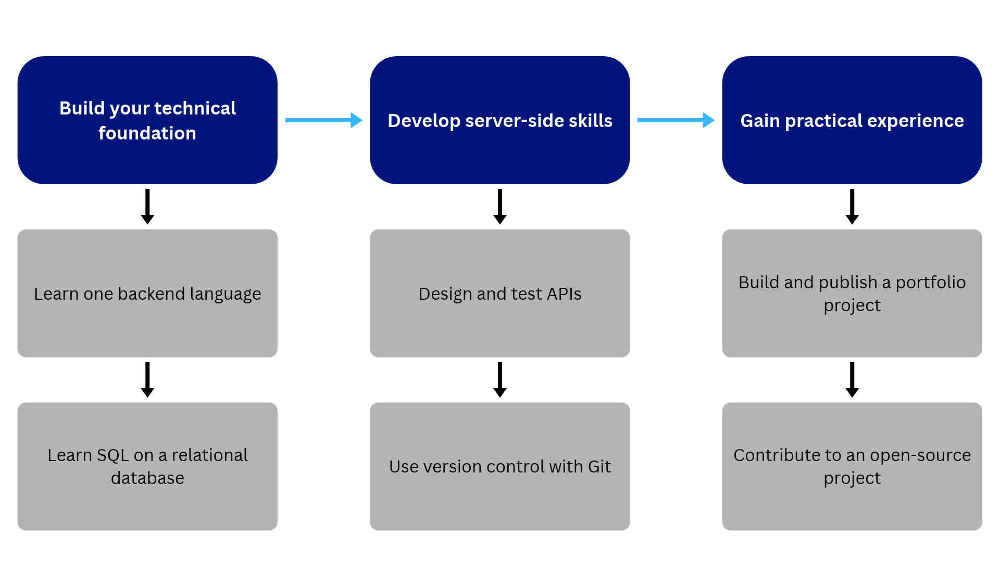

# Graduation Plan: Becoming a Backend Developer

## Table of Contents

- [Purpose](#purpose)
- [Building your technical foundation](#building-your-technical-foundation)
  - [Learning a backend language](#learning-a-backend-language)
  - [Understanding databases and SQL](#understanding-databases-and-sql)
- [Developing server-side skills](#developing-server-side-skills)
  - [Designing and testing APIs](#designing-and-testing-apis)
  - [Using version control with Git](#using-version-control-with-git)
- [Gaining practical experience](#gaining-practical-experience)
  - [Building portfolio projects](#building-portfolio-projects)
  - [Joining collaborative work](#joining-collaborative-work)
- [Presenting your skills to employers](#presenting-your-skills-to-employers)
  - [Polishing your resume](#polishing-your-resume)
  - [Preparing for technical interviews](#preparing-for-technical-interviews)
- [References](#references)

## Purpose

As a future Husky student, you seek guidance on finding a job in backend development. This document guides you through the practices that build the skills employers expect, from choosing a language to preparing for interviews. Figure 1 shows the order of the three stages that structure the plan. Following the stages in order builds each skill on the one before it. This plan explains the best practices that prepare you to apply for a backend developer role, so you graduate with the skills employers look for.

<b>Figure 1.</b> Backend developer skills roadmap

  

## Building your technical foundation

This section covers choosing a language to specialize in and database basics.

### Learning a backend language

Developers tend to cluster into small groups of widely used languages. In a 2026 Stack Overflow survey, 62% of developers used JavaScript, 58% used Python, 43% used TypeScript, and 27.6% used Java.[^1] Languages with such substantial use come with large communities, which gives you more libraries, examples, and answers to questions.

Choose one widely used backend language and build a deep understanding in that language before moving on to learn a second. Languages like Java and Python appear near the top of that ranking, which makes them safe choices for a first backend language.[^1]

### Understanding databases and SQL

Most backend features read or write stored data. In the same survey, 73% of developers used a database, and SQL ranked second among languages.[^1] Learn SQL on a relational database such as PostgreSQL, and start by creating a small project database.

## Developing server-side skills

This section covers designing and testing the application programming interfaces (APIs) that your backend exposes.

### Designing and testing APIs

Design your API around standard HTTP methods and nested URLs. Use GET, POST, PUT, PATCH, and DELETE instead of verbs in the URL, such as `/getorder`, which keeps URLs short and predictable. Nest related data, such as `/products/:productid/reviews`, so the URL mirrors how the data relates, which speeds onboarding and reduces errors.[^2]

Parse JSON with a standard library, because string handling silently misreads data when a new field, such as a middle name, appears. Write a test for every endpoint and load known-good data before each run, so the tests document how the API behaves and one run does not disturb the next.[^2]

### Using version control with Git

Commit small, single-purpose changes, because small commits keep merge conflicts rare and let you undo one mistake without losing other work. Write each commit message in the imperative mood and state one purpose, so the project history stays readable.[^3]

Develop every feature on its own branch, which keeps unstable code away from the main codeline until you finish testing it. Ask a teammate to review the branch before you merge it, since reviews catch problems early and spread knowledge across the team.[^3]

## Gaining practical experience

This section covers starting a project and making a first contribution.

### Building portfolio projects

Publish a small project that solves a real-world problem, because a published project lets other people discover, interact with, and respond to your work. The Open Source Guides cover how to start a project and find users for it.[^4] Grant Bowser, a software engineering student at Embry-Riddle Aeronautical University and co-founder of PARSEC, says "your education is more of just a stepping stone foundation to extra curriculars," which employers read as proof that you apply what you learn.[^5]

### Joining collaborative work

Make a first contribution to an existing open-source project, because contributing shows employers that you work well inside a shared codebase. Choose a project you already use, read its contributing guidelines, and submit a change such as a bug fix or feature.

## Presenting your skills to employers

This section covers tailoring your resume and preparing for interviews.

### Polishing your resume

Tailor your resume to each job posting, because recruiters screen against the job description. Quantify the impact of your projects with numbers such as users or team size, and list the technologies after the result. Link your best project and keep its README clean, so readers see your strongest work first.[^6]

### Preparing for technical interviews

Practice common backend questions and run mock interviews, because rehearsal and feedback set strong candidates apart. Answer behavioral questions in the Situation, Task, Action, Result (STAR) format, which keeps each answer clear and tied to an outcome.[^7]

## References

[^1]: R. Donovan, "The results of the 2026 Developer Survey are here!," *Stack Overflow Blog*, 6 October 2026. [Online]. Available: https://stackoverflow.blog/2026/10/06/the-results-of-the-2026-developer-survey-are-here/. [Accessed Nov. 25, 2026].

[^2]: M. Heusser, "16 REST API design best practices and guidelines," *TechTarget*, 3 April 2025. [Online]. Available: https://www.techtarget.com/searchapparchitecture/tip/16-REST-API-design-best-practices-and-guidelines. [Accessed Nov. 25, 2026].

[^3]: "What are Git version control best practices?," *GitLab*, n.d. [Online]. Available: https://about.gitlab.com/topics/version-control/version-control-best-practices. [Accessed Nov. 25, 2026].

[^4]: "Open Source Guides," *GitHub*, n.d. [Online]. Available: https://opensource.guide/. [Accessed Nov. 25, 2026].

[^5]: Bowser, Grant. Personal interview. 13 November 2026.

[^6]: G. Orosz, "How to write a developer resume that recruiters will read," *freeCodeCamp*, 13 November 2020. [Online]. Available: https://www.freecodecamp.org/news/how-to-write-a-developer-resume-recruiters-will-read/. [Accessed Nov. 25, 2026].

[^7]: "Back-end developer interview preparation guide (2026)," *Coursera*, n.d. [Online]. Available: https://www.coursera.org/resources/back-end-development-interview-prep-guide. [Accessed Nov. 25, 2026].